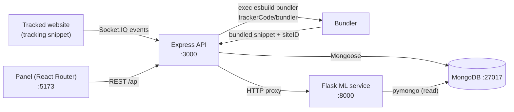

# SessionFlow

## What it is

SessionFlow is a website behavior analytics platform that you run locally. A
small browser snippet records visitor sessions, pages and form interactions and
streams them to a Node/Express API over Socket.IO; the API stores them in
MongoDB; a React dashboard shows visits, live-user counts and reports; and a
Flask service runs scikit-learn models over the stored data to produce segment,
shopping-habit and text-emotion summaries. It is a developer project, not a
hosted product, and there is no public demo.

Repository layout:

- `restServer/` - Express 5 + Socket.IO API and MongoDB (Mongoose) models.
- `panel/` - React Router 7 dashboard.
- `trackerCode/` - browser tracking snippet and its esbuild bundler.
- `pythonserver/` - Flask ML service (`ml-server/`) and training notebooks
  (`ml-training/`).
- `www/` - static nginx page used to exercise the snippet end to end.
- `plantuml/` - PlantUML architecture and data-model diagrams.

## Features

- Browser-side session tracking: click count, window focus-loss count, session
  duration and device type (mobile/tablet/desktop by viewport width)
  (`trackerCode/tracker.ts`).
- Page and section engagement measured with `IntersectionObserver` on elements
  carrying `data-ckcontent` / `data-ckcategory` attributes, including elements
  added later (`trackerCode/tracker.ts`).
- Form interaction capture for inputs whose name or id matches keywords such as
  `comment`, `message`, `min-price`, `max-price` and `gender`
  (`trackerCode/formService.ts`).
- Real-time ingestion of session, page and form payloads over Socket.IO events
  (`restServer/services/socket.ts`).
- Per-site tracking-code generation: the API bundles the snippet with esbuild
  and returns the resulting JavaScript plus a generated `siteID`
  (`restServer/router/index.ts`, `trackerCode/bundler/bundler2.js`).
- Account system with JWT login (7-day tokens) and bcrypt password hashing
  (`restServer/router/index.ts`, `restServer/services/bcrypt.ts`).
- Multi-site tenancy: each user owns sites keyed by a unique `siteID`
  (`restServer/schemas/site.schema.ts`, `restServer/services/db.ts`).
- Reporting endpoints: all sessions, daily / weekly / monthly and custom
  date-range reports, and a live-user count (`restServer/router/index.ts`,
  `restServer/services/db.ts`).
- Dashboard with a live-user tile and an interactive visit chart for daily,
  weekly, monthly and custom ranges
  (`panel/app/pages/dashboard/dashboard.tsx`).
- Site management from the dashboard: add and delete sites, regenerate tracking
  code, and trigger an ML model reload
  (`panel/app/pages/dashboard/system.tsx`,
  `panel/app/pages/dashboard/websiteadd.tsx`).
- ML reports over the stored data: k-means segmentation with 2, 3 and 5 clusters,
  shopping-habit trend classification (increasing / decreasing / stable) and
  LightGBM text-emotion classification (`pythonserver/ml-server/app.py`,
  `pythonserver/ml-server/utils/shopping_util.py`).
- Model retraining and reload endpoint that refits the k-means pipelines and
  reloads the saved models (`pythonserver/ml-server/app.py`, `/modelreload`).
- Training notebooks for the k-means and LightGBM models
  (`pythonserver/ml-training/`).
- Local MongoDB for development via Docker Compose
  (`restServer/compose.yaml`).
- Static nginx demo page that loads the bundled snippet, for local end-to-end
  testing (`www/web/index.html`, `www/docker-compose.yaml`).

## Tech stack

- Backend: TypeScript on Node.js, Express 5, Socket.IO, Mongoose / MongoDB,
  `jsonwebtoken`, `bcrypt`, `morgan`, run with `tsx`
  (`restServer/package.json`).
- Frontend: React 19, React Router 7, Vite 6, Tailwind CSS 4 with daisyUI 5,
  Recharts and Zustand (`panel/package.json`, `panel/vite.config.ts`).
- Tracking bundle: TypeScript compiled by esbuild to a browser ESM bundle
  (`trackerCode/package.json`, `trackerCode/bundler/index.js`).
- Machine learning: Python with Flask, scikit-learn, pandas, joblib and pymongo,
  served by hypercorn (`pythonserver/ml-server/app.py`,
  `pythonserver/requirements.txt`).
- Runtime/infra: Docker Compose for MongoDB and nginx; a multi-stage Dockerfile
  for the dashboard (`restServer/compose.yaml`, `www/docker-compose.yaml`,
  `panel/Dockerfile`).

## Architecture



The tracked page loads a snippet whose URL and `siteID` are baked in at build
time (`trackerCode/bundler/bundler2.js`), then opens a Socket.IO connection and
emits `userData`, `pageData` and `formData` events
(`trackerCode/tracker.ts`, `restServer/services/socket.ts`). The Express API
protects its account, site and ML routes with a JWT guard (routes such as
`usercreate` and `userlogin` are public) and, for the ML routes, proxies the
request to the Flask service (`restServer/router/index.ts`). Both the API
(writes) and the Flask service (reads) use the same MongoDB database named
`tas2`, with collections for `user`, `site`, `sessions`, `page` and `form`
related one-to-many (`restServer/schemas/`, `pythonserver/ml-server/db.py`,
`plantuml/sunu.puml`).

## Getting started

Prerequisites: Node.js and pnpm (the lockfiles are `pnpm-lock.yaml`), Docker with
Docker Compose, and Python 3 for the ML service.

### 1. API and database

```bash
cd restServer
pnpm install
pnpm run dev
```

`pnpm run dev` runs `docker-compose up -d --build` (starting MongoDB from
`restServer/compose.yaml` on port 27017) and then `tsx --watch index.ts`. The API
listens on port 3000 (`restServer/config.json`, `restServer/index.ts`).

### 2. Dashboard

```bash
cd panel
pnpm install
pnpm run dev
```

The dashboard is served by the React Router/Vite dev server on
`http://localhost:5173` and calls the API at `http://localhost:3000/api`
(the host is currently hardcoded in the dashboard pages, for example
`panel/app/pages/dashboard/dashboard.tsx`).

### 3. ML service

```bash
cd pythonserver/ml-server
python3 -m venv .venv
source .venv/bin/activate
pip install -r ../requirements.txt
hypercorn app:app
```

This starts the Flask app on port 8000, matching `ml_server.serverurl` in
`restServer/config.json`. Note: `pythonserver/requirements.txt` does not list
every package the app imports. The service also needs `pandas`, `pymongo`,
`joblib` and `lightgbm` (`pythonserver/ml-server/app.py`). The `restServer`
package also has a `dev:py` script that runs the same command, but it expects a
virtualenv at `../.venv` relative to `restServer` (`restServer/package.json`).

### 4. Tracking snippet

```bash
cd trackerCode
pnpm install
pnpm run bundle
```

`pnpm run bundle` runs
`TRACKER_URL=http://localhost:3000 node ./bundler/index.js`, which writes the
browser ESM bundle to `trackerCode/dist/bundle.js`. The `pnpm run serve` script
then runs `zx ./script.mjs`, which copies the bundle to `www/web/script.js` and
starts the nginx demo page on port 8088; `zx` is not declared in
`trackerCode/package.json`, so that step requires `zx` to be installed
separately.

### 5. Demo page (optional)

```bash
cd www
docker-compose up -d --build
```

This serves `www/web/` with nginx on `http://localhost:8088`. The page loads
`www/web/script.js`, a previously built copy of the tracking bundle; refresh it
from step 4 with `pnpm run serve`. It is a ready-made target for local testing.

### Configuration

The API reads its JWT signing secret from the `JWT_SECRET` environment variable
(`restServer/router/index.ts`); it is no longer read from
`restServer/config.json`. Provide it in the environment before starting
`restServer` - `.env.example` documents the variable name and a placeholder.
Other settings (server port and CORS, the `ml_server` URL, the MongoDB URL and
database name, and Socket.IO CORS) remain in `restServer/config.json`.

## Usage example

Create a user and log in:

```bash
curl -s -X POST http://localhost:3000/api/usercreate \
  -H 'Content-Type: application/json' \
  -d '{"email":"you@example.com","password":"secret","firstName":"Ada","lastName":"Lovelace"}'

curl -s -X POST http://localhost:3000/api/userlogin \
  -H 'Content-Type: application/json' \
  -d '{"email":"you@example.com","password":"secret"}'
# -> {"message":"...","error":false,"data":{"token":"<JWT>"}}
```

Generate a tracking snippet and register the site (replace `<JWT>` with the token
from the login response):

```bash
curl -s -X POST http://localhost:3000/api/getwebsitecode \
  -H 'Authorization: Bearer <JWT>' -H 'Content-Type: application/json' \
  -d '{"websiteURL":"https://example.com"}'
# -> {"message":"...","error":false,"data":{"code":"<bundled js>","siteID":"<uuid>"}}

curl -s -X POST http://localhost:3000/api/addsite \
  -H 'Authorization: Bearer <JWT>' -H 'Content-Type: application/json' \
  -d '{"name":"Example","websiteURL":"https://example.com","siteID":"<uuid>"}'
```

Paste the returned `code` before `</body>` on the target site (the `www/web/`
demo page already contains a copy). Open the tracked site so the snippet connects
and emits data, then open the dashboard at `http://localhost:5173` to see the live
user count and visit chart. To fetch an ML report through the API proxy:

```bash
curl -s -X POST http://localhost:3000/api/segment3 \
  -H 'Authorization: Bearer <JWT>' -H 'Content-Type: application/json' -d '{}'
# -> per-cluster aggregation of device type, gender and numeric fields
```

The ML handlers read their input from MongoDB rather than the request body, so an
empty JSON object is sufficient (`pythonserver/ml-server/app.py`).

## Status and license

Implemented and wired end to end:

- The tracking snippet, Socket.IO ingestion, MongoDB models, JWT/bcrypt account
  flow, REST reporting endpoints and tracking-code generation
  (`trackerCode/`, `restServer/`).
- The dashboard pages for home, login, register, dashboard, visit reports,
  detailed reports, settings and system management (`panel/app/pages/`).
- The Flask ML endpoints together with committed model files under
  `pythonserver/ml-server/models/` (`kmeans_2segment.pkl`, `kmeans_3segment.pkl`,
  `kmeans_5segment.pkl`, `lightgbm.pkl`).

Experimental, partial or not wired:

- Socket authentication is disabled: the `io.use(...)` middleware is commented
  out in `restServer/index.ts`, so Socket.IO connections are not JWT-verified even
  though the snippet sends a token.
- The IP/security model is imported but unused, and its request middleware is
  commented out (`restServer/index.ts`,
  `restServer/schemas/security.schema.ts`).
- Scroll tracking currently collects nothing (`trackScroll` in
  `trackerCode/tracker.ts`).
- Model training is done in Jupyter notebooks (`pythonserver/ml-training/`) and is
  not automated; the running service loads the committed `.pkl` files.
- `pythonserver/requirements.txt` is missing several imports the app needs
  (`pandas`, `pymongo`, `joblib`, `lightgbm`).
- `sonrada.md` is a personal Turkish TODO list and `tempCodeRunnerFile.js` is a
  MongoDB playground snippet; neither is part of the application.
- There is no automated test suite in the repository.

License: no `LICENSE` file is present. `restServer/package.json` and
`trackerCode/package.json` declare `"license": "ISC"`, and `panel/package.json`
is marked `"private": true`. Confirm the intended license with the author before
reusing the code.
